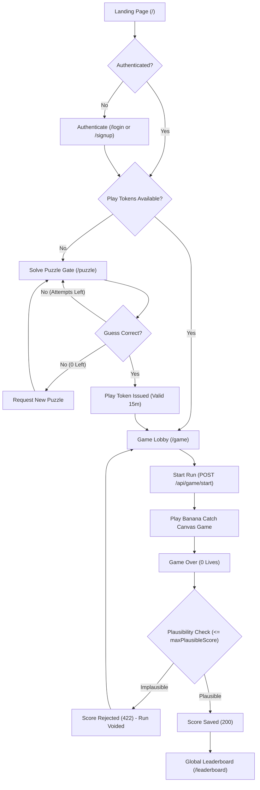

# Banana Arcade

Banana Arcade is a full-stack web arcade game where players register, authenticate, solve an external mathematical visual puzzle to unlock the game gate, receive a single-use arcade play token, and play the 2D canvas-based "Banana Catch" game. Submitted scores undergo server-side plausibility validation against elapsed time before being recorded to a persistent SQLite database, with highest personal scores ranked on a global leaderboard.

---

## Table of Contents

1. [How It Works (User Flow)](#how-it-works-user-flow)
2. [System Architecture & Topology](#system-architecture--topology)
3. [Tech Stack & Prerequisites](#tech-stack--prerequisites)
4. [Setup and Run Instructions](#setup-and-run-instructions)
5. [Automated Test Suite & Verification](#automated-test-suite--verification)
6. [Complete REST API Specification](#complete-rest-api-specification)
7. [The Four Coursework Themes (CIS046-3)](#the-four-coursework-themes-cis046-3)
8. [Security Architecture & Protections](#security-architecture--protections)
9. [Known Limitations & Trade-offs](#known-limitations--trade-offs)
10. [Third-Party & AI Attribution Registry](#third-party--ai-attribution-registry)
11. [Credits and Banana API Terms of Use](#credits-and-banana-api-terms-of-use)

---

## How It Works (User Flow)

The application flow proceeds in sequential stages:

1. **Account Registration and Login**: A player creates an account or logs in at `/signup` or `/login`. Passwords are validated and hashed using `bcrypt` (work factor 12), and the server issues an HTTP-only session cookie (`banana.sid`).
2. **Puzzle Gate Challenge**: Upon authentication, the player visits the protected `/puzzle` route. The server fetches a mathematical puzzle from the external Banana API, securely stores the solution in the SQLite database, and returns the puzzle image and puzzle ID to the client without exposing the solution.
3. **Solving the Puzzle**: The player views the puzzle image with a live countdown timer and submits a single-digit guess (0–9) via the clickable number pad within three attempts. If solved correctly, the server marks the puzzle solved and atomically generates a single-use arcade play token valid for 15 minutes.
4. **Game Unlock**: With an available play token, the player enters `/game` and initiates a run. The server spends the oldest unused token inside an atomic transaction, marks it as started, and returns a unique `runId` and start timestamp.
5. **Gameplay (Banana Catch)**: The player controls a basket across a canvas using keyboard arrow keys (or A/D) or pointer/touch drag. Bananas fall from the top; catching healthy bananas awards points and advances levels every 10 catches, while catching spoiled bananas or letting healthy bananas drop off the bottom reduces the player's 3 lives. The game pauses automatically if the player switches tabs or clicks Pause.
6. **Score Submission & Plausibility Validation**: When lives reach zero, the client submits only `runId` and final score to `POST /api/game/finish`. The server verifies elapsed time and verifies that the score does not exceed the theoretical physical upper limit of possible spawns (`Math.floor(elapsedMs / 500) + 1`). Valid scores are saved; impossible scores are rejected with HTTP 422 and the run is voided.
7. **Global Leaderboard**: The player navigates to `/leaderboard` to view the top 10 player rankings ordered by highest score and broken by earliest achievement timestamp, along with their personal rank.

---

## System Architecture & Topology

Banana Arcade is organized into a clean three-tier topology:

```
+-------------------------------------------------------+
|                      TIER 1: BROWSER                  |
|  React 18 + Vite SPA | HTML5 Canvas 2D | Vanilla JS   |
+-------------------------------------------------------+
                           │   ▲
            REST / JSON    │   │   Same-Origin via Vite
     (credentials: include)│   │   Development Proxy (/api)
                           ▼   │
+-------------------------------------------------------+
|                   TIER 2: BACKEND SERVER              |
|  Node.js + Express | SQLite (better-sqlite3)          |
|  Session Store | Token Issuance | Plausibility Engine |
+-------------------------------------------------------+
                           │   ▲
                           │   │   HTTP GET (out=json, base64=yes)
       AbortController     │   │   Server-Side Only
       5000ms Timeout      ▼   │   (Client never contacts Tier 3)
+-------------------------------------------------------+
|                 TIER 3: BANANA PUZZLE API             |
|  External Service: marcconrad.com/uob/banana/api.php  |
|  Generates mathematical puzzle image and solution     |
+-------------------------------------------------------+
```

### User Flow Diagram



### Puzzle Verification Sequence Diagram

```mermaid
sequenceDiagram
    autonumber
    actor User as Player (Browser)
    participant Client as React Client (PuzzlePage)
    participant Server as Express Server (puzzleService)
    participant DB as SQLite Database
    participant Banana as Banana API (marcconrad.com)

    User->>Client: Open Puzzle Gate (/puzzle)
    Client->>Server: POST /api/puzzle/new
    Server->>Banana: GET /uob/banana/api.php?out=json&base64=yes (Timeout: 5000ms)
    Banana-->>Server: JSON { question: base64PNG, solution: digit }
    Server->>DB: INSERT INTO puzzles (id, user_id, solution, image, status, expires_at)
    Server-->>Client: HTTP 201 Created { id, image, expiresAt, maxAttempts } (NO SOLUTION)
    Client->>User: Display puzzle image and countdown timer

    User->>Client: Input single digit (0-9) and submit
    Client->>Server: POST /api/puzzle/:id/answer { guess }
    activate Server
    Note over Server,DB: Transaction: SELECT puzzle, check user_id, expiry, and attempts
    alt Guess is Correct
        Server->>DB: UPDATE puzzles SET status = 'solved'; INSERT INTO play_tokens (status = 'unused')
        Server-->>Client: HTTP 200 OK { correct: true, unlocked: true }
        Client->>User: Display "Puzzle Solved! Correct answer!"
    else Guess is Wrong (Attempts > 0)
        Server->>DB: UPDATE puzzles SET attempts = attempts + 1
        Server-->>Client: HTTP 200 OK { correct: false, attemptsLeft: N }
        Client->>User: Display remaining attempts warning
    else Guess is Wrong (Attempts = 0)
        Server->>DB: UPDATE puzzles SET status = 'failed'
        Server-->>Client: HTTP 200 OK { correct: false, attemptsLeft: 0, failed: true }
        Client->>User: Display failure message & "New Puzzle" button
    end
    deactivate Server
```

---

## Tech Stack & Prerequisites

- **Frontend**: React 18, React Router DOM v6, Vite, HTML5 Canvas 2D API, vanilla JavaScript (zero external game frameworks or art libraries).
- **Backend**: Node.js, Express, `express-session` (in-memory store for development), `better-sqlite3`, `helmet`, `express-rate-limit`, `bcrypt`.
- **Database**: SQLite (file-based relational storage with foreign key constraints and transactional integrity).
- **Testing**: Node.js built-in test runner (`node --test`), `assert` module.
- **External Integration**: Banana Puzzle API (`http://marcconrad.com/uob/banana/api.php`) consumed strictly by Tier 2.

### Prerequisites
- **Node.js**: Node.js v20.x
- **npm**: npm v10.x
- **Git**: Git v2.x

---

## Setup and Run Instructions

Follow these exact steps to install, configure, and launch the application:

1. **Clone the repository**:
   ```bash
   git clone <repository-url>
   cd banana-clash
   ```

2. **Configure backend environment variables**:
   ```bash
   cp server/.env.example server/.env
   ```

3. **Generate a secure random session secret**:
   Generate a cryptographic 64-character hexadecimal string using Node's crypto module:
   ```bash
   node -e "console.log(require('crypto').randomBytes(32).toString('hex'))"
   ```
   Open `server/.env` and replace `replace-with-a-random-session-secret` on the `SESSION_SECRET` line with the generated value.

4. **Install all dependencies**:
   ```bash
   npm run install:all
   ```

5. **Start the application**:
   - Terminal 1 (Backend Express server):
     ```bash
     npm --prefix server run dev
     ```
   - Terminal 2 (Frontend Vite development server):
     ```bash
     npm --prefix client run dev
     ```

6. **Access the application**:
   - **Frontend UI (React client)**: [http://localhost:5173](http://localhost:5173)
   - **Backend API (Express server)**: [http://localhost:3000](http://localhost:3000)

---

## Automated Test Suite & Verification

Automated unit and integration test suites run without external test runners or browser dependencies using Node's native `node --test`:

```bash
# Run all server and client test suites
npm test

# Run server test suite only (24 tests)
npm run test:server

# Run client test suite only (18 tests)
npm run test:client
```

### Test Suite Breakdown

| Suite | File | Tests | Key Scenarios Covered |
|:---|:---|:---:|:---|
| **Puzzle Service** | `server/tests/puzzleService.test.js` | 7 | Correct answer marks puzzle solved and issues token; wrong answer decrements attempts; failure after 3 wrong guesses; expiration handling; other-user isolation (404); duplicate solve prevention; safe cleanup of old failed/expired puzzles preserving solved puzzles. |
| **Token Service** | `server/tests/tokenService.test.js` | 8 | Token creation on correct solve; zero tokens on wrong guess; `startRun` spending oldest unused token atomically; 0 tokens returning null; expired token rejection; other-user token isolation; concurrency double-click protection; run expiration after `RUN_MAX_SECONDS`. |
| **Score Service** | `server/tests/scoreService.test.js` | 9 | `maxPlausibleScore` upper bound math across intervals; `finishRun` saving plausible scores; rejecting scores exceeding physical bounds (422); rejecting negative/fractional/non-numeric scores; idempotent duplicate completion; other-user run isolation; unused token rejection; expired run duration handling; `getLeaderboard` CTE ranking, tie-breaking by earliest achievement timestamp, personal rank calculation, and total omission of user IDs. |
| **Collision Engine** | `client/tests/collision.test.js` | 6 | 2D Axis-Aligned Bounding Box (AABB) intersection (`rectsOverlap`); complete/partial overlap; horizontal/vertical separation; edge-touching; corner overlaps; null/undefined safety. |
| **Event Emitter** | `client/tests/emitter.test.js` | 6 | Event registration and payload delivery; cleanup callback unsubscription; `off()` method; independent multi-listener dispatch; emission with zero listeners; safe unsubscription during active dispatch. |
| **Auth Validation** | `client/tests/validation.test.js` | 6 | Username alphanumeric and length constraints (3–20 chars); whitespace/special character rejection; password length constraints (8–72 chars); null/empty input rejection. |
| **Total** | | **42 / 42 Pass** | **100% Pass Rate** |

---

## Complete REST API Specification

All state-changing endpoints (`POST`) are protected by `originCheck`. All authentication and dynamic gameplay responses serve `Cache-Control: no-store`.

| Method | Path | Auth Required | Rate Limit | Request Body | Success Response | Error Responses |
|:---|:---|:---|:---|:---|:---|:---|
| `GET` | `/api/health` | No | None | *None* | `200 OK`<br>`{"status": "ok", "time": "..."}` | `500` Internal Server Error |
| `POST` | `/api/auth/signup` | No | `authRateLimiter`<br>(10 req / 15m) | `{"username": "<3-20 chars>", "password": "<8-72 chars>"}` | `201 Created`<br>`{"user": {"id": 1, "username": "alice"}}` | `400` Validation failure<br>`409` Username taken<br>`415` Unsupported Media Type<br>`429` Too Many Requests |
| `POST` | `/api/auth/login` | No | `authRateLimiter`<br>(10 req / 15m) | `{"username": "<string>", "password": "<string>"}` | `200 OK`<br>`{"user": {"id": 1, "username": "alice"}}` | `401` Invalid username or password<br>`415` Unsupported Media Type<br>`429` Too Many Requests |
| `POST` | `/api/auth/logout` | No | None | *None* | `200 OK`<br>`{"ok": true}` | `500` Internal Server Error |
| `GET` | `/api/auth/me` | **Yes** (`requireLogin`) | None | *None* | `200 OK`<br>`{"user": {"id": 1, "username": "alice"}}` | `401` Not logged in |
| `POST` | `/api/puzzle/new` | **Yes** (`requireLogin`) | `puzzleLimiter`<br>(20 req / 10m) | *None* | `201 Created`<br>`{"id": "<UUID>", "image": "<base64>", "expiresAt": "<ISO>", "maxAttempts": 3}` | `401` Not logged in<br>`429` Too many puzzles<br>`502` Puzzle service unavailable |
| `POST` | `/api/puzzle/:id/answer` | **Yes** (`requireLogin`) | None *(max 3 attempts)* | `{"guess": "<single digit 0-9>"}` | `200 OK`<br>- Correct: `{"correct": true, "unlocked": true}`<br>- Wrong: `{"correct": false, "attemptsLeft": N}`<br>- Failed: `{"correct": false, "attemptsLeft": 0, "failed": true}` | `400` Not a single digit<br>`401` Not logged in<br>`404` Puzzle not found<br>`409` Not active<br>`410` Expired |
| `GET` | `/api/game/status` | **Yes** (`requireLogin`) | None | *None* | `200 OK`<br>`{"tokensAvailable": <number>}` | `401` Not logged in |
| `POST` | `/api/game/start` | **Yes** (`requireLogin`) | `gameLimiter`<br>(10 req / 1m) | `{}` | `201 Created`<br>`{"runId": "<UUID>", "startedAt": "<ISO>"}` | `401` Not logged in<br>`403` No tokens available<br>`429` Too many requests |
| `POST` | `/api/game/finish` | **Yes** (`requireLogin`) | `gameLimiter`<br>(10 req / 1m) | `{"runId": "<UUID>", "score": <int>}` | `200 OK`<br>- Saved: `{"saved": true, "score": 15}`<br>- Duplicate: `{"saved": true, "score": 15, "alreadySaved": true}` | `400` Invalid UUID/score<br>`401` Not logged in<br>`404` Not found<br>`409` Not active<br>`410` Expired<br>`422` Score rejected |
| `GET` | `/api/leaderboard` | No (Public) | None | *None* | `200 OK`<br>`{"leaderboard": [{"rank": 1, "username": "alice", "bestScore": 25, "achievedAt": "..."}], "me": {"rank": 3, "bestScore": 15} \| null}` | `500` Internal Server Error |
| `ALL` | `/api/*` | No | None | *Any* | *None* | `404 Not Found` |

---

## The Four Coursework Themes (CIS046-3)

### Theme 1: Version Control
- **Commit History & Workflow**: Incremental milestone commits documenting steps 1 to 6 (skeleton, auth & sessions, puzzle gate, play tokens, game engine, plausibility checks & hardening).
- **Clean Repository Exclusions**:
  - `.gitignore`: Excludes `node_modules/`, `.env`, SQLite database files (`*.db`, `data/`), logs, OS files (`.DS_Store`), and archive outputs.
  - `package.json`: Automated script `"package:code"` uses `git archive --format=zip --output=banana-arcade-code.zip HEAD` to package only committed files without packaging development artifacts or local credentials.
- **Configuration Templates**: Committed template `server/.env.example` provides variable names and safe defaults; `server/config/index.js` enforces fail-fast startup checks rejecting placeholder secret keys.

### Theme 2: Events
- **Custom Event Emitter**: Lightweight standalone `EventEmitter` class (`client/src/events/emitter.js`) with `on`, `off`, `emit`, snapshot listener dispatch, and cleanup unsubscribe functions.
- **Decoupled Game Engine Event Model**: `client/src/game/Game.js` emits domain events (`start`, `pause`, `resume`, `catch`, `levelUp`, `lifeLost`, `miss`, `gameOver`) completely decoupled from the React rendering pipeline.
- **React UI Integration**: `client/src/components/GameCanvas.jsx` subscribes to game engine events inside `useEffect`, updating heads-up display state (score, lives, level, pause status) and safely unsubscribing on unmount (StrictMode safe).
- **DOM & Browser Events**: `client/src/game/input.js` handles keyboard (`keydown`, `keyup` for Arrow keys and A/D) and pointer dragging (`pointerdown`, `pointermove`, `pointerup`, `pointercancel`). Tab visibility changes (`visibilitychange`) automatically trigger game pauses.

### Theme 3: Interoperability
- **Three-Tier Boundary Architecture**: Clear separation between React presentation tier, Express application tier, and external Banana Puzzle API.
- **External API Normalization & Resilience**: `server/services/bananaService.js` consumes external HTTP endpoint with `AbortController` timeout (5000ms), parses external fields (`question` base64 image and `solution` integer), and maps upstream errors to internal `BananaServiceError` (HTTP 502).
- **Client-to-Server Protocol**: JSON over HTTP with structured error payloads (`{ error: string }`). Strict header enforcement via `server/middleware/requireJson.js` returning HTTP 415. Development `/api` proxy in `client/vite.config.js` maintains same-origin semantics during local development.
- **Data Encapsulation**: The client browser never communicates directly with `marcconrad.com`, avoiding mixed-content security blocks and preventing leakage of puzzle solutions.

### Theme 4: Virtual Identity
- **Credential Storage & Authentication**: `server/controllers/authController.js` hashes passwords using `bcrypt` (work factor 12) with input validation (3–20 alphanumeric username, 8–72 char password).
- **Timing Attack Mitigation**: When a queried username does not exist during login, candidate passwords are evaluated against a fixed dummy hash (`DUMMY_HASH`) to equalize response time and prevent username-enumeration side channels.
- **Session Lifecycle & Hardening**: `express-session` with `banana.sid` cookie, `HttpOnly`, `SameSite: 'lax'`, 2-hour expiration, and explicit `req.session.regenerate()` on signup and login to eliminate session fixation. Protected routes guarded by `server/middleware/requireLogin.js`.
- **Identity-Scoped Authorization**: Resources are bound to `user_id` in SQLite:
  - `server/services/puzzleService.js`: Queries filter by `id = ? AND user_id = ?`, returning 404 for other users' resources to prevent ID enumeration.
  - `server/services/tokenService.js`: Tokens are spent strictly by their owner inside an atomic SQLite transaction.
  - `server/services/scoreService.js`: Finishing a run requires matching `user_id`.
- **Public Identity Protection**: `server/controllers/leaderboardController.js` returns only `rank`, `username`, `bestScore`, and `achievedAt`, never exposing internal database IDs (`id`, `user_id`) or security attributes.

---

## Security Architecture & Protections

| Protection | Implementation | File Location |
|:---|:---|:---|
| **Password Hashing** | Salted and hashed using `bcrypt` with work factor 12. | `server/controllers/authController.js` |
| **Login Timing Equalisation** | Compares candidate passwords against a fixed dummy hash when a user does not exist. | `server/controllers/authController.js` |
| **Session Fixation Prevention** | Session IDs destroyed and regenerated with `req.session.regenerate()` upon login and signup. | `server/controllers/authController.js` |
| **Session Cookie Flags** | `banana.sid` enforces `HttpOnly`, `SameSite: 'lax'`, and production `Secure` flags. | `server/app.js` |
| **Session Lifetime** | Inactive sessions expire after 2 hours (`maxAge: 2 * 60 * 60 * 1000`). | `server/app.js` |
| **Rate Limiting** | IP-scoped limits on auth (10 req/15m); session-scoped limits on puzzles (20 req/10m) and game runs (10 req/1m). | `server/middleware/rateLimiters.js` |
| **Input Validation** | Strict regex and type checks on usernames, passwords, puzzle guesses (single digit 0–9), and UUIDs. | `server/controllers/*`, `client/src/utils/validation.js` |
| **SQL Injection Neutralization** | 100% of SQLite database queries use parameterized prepared statements via `better-sqlite3`. | Throughout `server/db/`, `server/services/` |
| **Server-Side Secret Storage** | Puzzle solutions are stored in SQLite and completely omitted from client HTTP responses. | `server/services/puzzleService.js` |
| **Atomic Token Spending** | Token verification and status updates run inside a synchronous SQLite transaction to eliminate TOCTOU double-spending. | `server/services/tokenService.js` |
| **Score Plausibility Check** | Submitted scores are evaluated against elapsed time (`Math.floor(elapsedMs / 500) + 1`); impossible scores rejected with 422. | `server/config/gameRules.js`, `server/services/scoreService.js` |
| **Idempotent Score Submission** | Submitting a score for a finished run safely returns HTTP 200 with `{ alreadySaved: true }` without database mutation. | `server/services/scoreService.js` |
| **Enumeration Defense** | Resource lookups filter by `id = ? AND user_id = ?`, returning 404 rather than 403 to prevent ID probing. | `server/services/puzzleService.js`, `server/services/scoreService.js` |
| **Security Headers (`helmet`)** | Disables `X-Powered-By`; adds HSTS, X-Content-Type-Options, X-Frame-Options, and Origin-Agent-Cluster headers. | `server/app.js` |
| **Origin Check Middleware** | Inspects `Origin` headers on mutating requests (POST), rejecting unrecognized origins with HTTP 403. | `server/middleware/originCheck.js` |

---

## Known Limitations & Trade-offs

1. **In-Memory Session Store (`MemoryStore`)**: `express-session` uses memory storage for local development. Active sessions reset when the server restarts and cannot scale across multi-node clusters. In production, Redis or a database session store should be used.
2. **Absence of Cryptographic Synchronizer CSRF Tokens**: State-changing requests rely on cookie `SameSite=Lax` and custom `Origin` header checking rather than per-request cryptographic tokens.
3. **No Email Verification or MFA**: Accounts are registered without email address confirmation or two-factor authentication.
4. **Score Plausibility is Not Proof of Human Play**: Server-side bounds checking catches impossible scores and speedhacks, but cannot prove human play over an automated timing bot.
5. **Third-Party API Dependency**: The Banana Puzzle API is hosted on an unencrypted HTTP endpoint outside our control. If the remote service is disrupted, puzzle requests return HTTP 502.
6. **Plain-Text Solutions in Database**: Active puzzle solutions (single digits 0–9) are stored unhashed in SQLite to enable evaluation. Database compromise would expose active puzzle answers.

---

## Third-Party & AI Attribution Registry

| File | Source | What Was Used / Implemented | Date |
|:---|:---|:---|:---:|
| `Banana API` | [http://marcconrad.com/uob/banana/doc.php](http://marcconrad.com/uob/banana/doc.php) | Third-party banana puzzle generator API; non-commercial educational use only | 2026-10-30 |
| `package.json` | Student implementation | Root package metadata and scripts for install:all, dev, test runner, and package:code | 2026-10-30 |
| `server/package.json` | AI-assisted (Antigravity) | ES module configuration, dependencies (`express`, `bcrypt`, `better-sqlite3`, `helmet`, `express-rate-limit`, `dotenv`) | 2026-10-29 |
| `server/.env.example` | AI-assisted (Antigravity) | Environment template with safe default configuration keys | 2026-10-29 |
| `server/config/index.js` | AI-assisted (Antigravity) | Environment configuration loader with fail-fast validation for `SESSION_SECRET` and positive integer checks | 2026-10-29 |
| `server/config/gameRules.js` | AI-assisted (Antigravity) | Server-side validation constants and `maxPlausibleScore` upper-bound function | 2026-10-30 |
| `server/db/schema.sql` | AI-assisted (Antigravity) | SQL schema defining `users`, `puzzles`, and `play_tokens` tables with check constraints and foreign keys | 2026-10-29 |
| `server/db/index.js` | AI-assisted (Antigravity) | SQLite database initialization with `better-sqlite3`, foreign keys, and schema execution | 2026-10-29 |
| `server/middleware/requireLogin.js` | AI-assisted (Antigravity) | Authentication guard middleware returning HTTP 401 when unauthenticated | 2026-10-29 |
| `server/middleware/requireJson.js` | AI-assisted (Antigravity) | Middleware enforcing `Content-Type: application/json` on POST requests returning HTTP 415 | 2026-10-30 |
| `server/middleware/rateLimiters.js` | AI-assisted (Antigravity) | IP-based auth limiter (10 req/15m), user-based puzzle limiter (20 req/10m), and game limiter (10 req/1m) | 2026-10-29 |
| `server/middleware/originCheck.js` | AI-assisted (Antigravity) | Origin validation middleware for mutating requests as defense-in-depth | 2026-10-30 |
| `server/controllers/authController.js` | AI-assisted (Antigravity) | Handlers for user signup (bcrypt cost 12), login (dummy hash timing mitigation), logout, and getMe | 2026-10-29 |
| `server/controllers/puzzleController.js` | AI-assisted (Antigravity) | HTTP controllers mapping puzzle service results to 201, 200, 400, 404, 409, 410 statuses | 2026-10-30 |
| `server/controllers/gameController.js` | AI-assisted (Antigravity) | Handlers for `getStatus`, `start` (spending token), and `finish` (validating score) | 2026-10-30 |
| `server/controllers/leaderboardController.js` | AI-assisted (Antigravity) | Public leaderboard handler returning top 10 and session user rank with `Cache-Control: no-store` | 2026-10-30 |
| `server/routes/*` | AI-assisted (Antigravity) | Express routers mounted at `/api/auth`, `/api/puzzle`, `/api/game`, `/api/leaderboard` | 2026-10-29 |
| `server/services/bananaService.js` | AI-assisted (Antigravity) | Banana API integration with built-in fetch, AbortController timeout, validation, and generic `BananaServiceError` | 2026-10-30 |
| `server/services/puzzleService.js` | AI-assisted (Antigravity) | Puzzle lifecycle management (`createPuzzle`, transactional `checkAnswer`, `cleanupOldPuzzles`) | 2026-10-30 |
| `server/services/tokenService.js` | AI-assisted (Antigravity) | Play token lifecycle (`createTokenForPuzzle`, `expireStaleTokens`, `countAvailable`, atomic `startRun`) | 2026-10-30 |
| `server/services/scoreService.js` | AI-assisted (Antigravity) | Transactional `finishRun` with plausibility checks and `getLeaderboard` CTE query with tie-breaking | 2026-10-30 |
| `server/app.js` | AI-assisted (Antigravity) | Express app setup with `express-session`, `helmet`, `originCheck`, and centralized error handling | 2026-10-29 |
| `server/tests/*` | AI-assisted (Antigravity) | Automated unit tests covering `puzzleService`, `tokenService`, and `scoreService` using in-memory SQLite | 2026-10-30 |
| `client/package.json` | AI-assisted (Antigravity) | Client scripts (`dev`, `build`, `test`), dependencies (`react`, `react-dom`, `react-router-dom`, `vite`) | 2026-10-29 |
| `client/vite.config.js` | AI-assisted (Antigravity) | Vite build tool configuration with React plugin and development `/api` proxy | 2026-10-30 |
| `client/css/style.css` | Student implementation | Base CSS stylesheet with cross-browser resets and typography | 2026-10-30 |
| `client/src/api/client.js` | AI-assisted (Antigravity) | Standardized API client helper for fetch, credentials, headers, and error handling | 2026-10-31 |
| `client/src/api/*` | AI-assisted (Antigravity) | Client fetch functions for `auth.js`, `puzzle.js`, `game.js`, `leaderboard.js` using `apiFetch` | 2026-10-29 |
| `client/src/context/AuthContext.jsx` | AI-assisted (Antigravity) | React Context managing user authentication state and session hydration on initial load | 2026-10-29 |
| `client/src/hooks/useAuth.js` | AI-assisted (Antigravity) | React hook providing access to `AuthContext` | 2026-10-29 |
| `client/src/utils/validation.js` | AI-assisted (Antigravity) | Shared client-side authentication credential validation | 2026-10-31 |
| `client/src/events/emitter.js` | AI-assisted (Antigravity) | Lightweight custom `EventEmitter` class with `on`, `off`, `emit`, and unsubscribe cleanup function | 2026-10-30 |
| `client/src/game/config.js` | AI-assisted (Antigravity) | Game configuration constants (dimensions, speeds, intervals, lives, frame caps, collision sizes) | 2026-10-30 |
| `client/src/game/collision.js` | AI-assisted (Antigravity) | Pure function `rectsOverlap` for 2D axis-aligned bounding box collision detection | 2026-10-30 |
| `client/src/game/input.js` | AI-assisted (Antigravity) | Input controller tracking keyboard (Arrows, A/D) and pointer/touch canvas drag with listener cleanup | 2026-10-30 |
| `client/src/game/entities.js` | AI-assisted (Antigravity) | Plain JS entity classes for `Basket` and `FallingItem` with bounds and physics updates | 2026-10-30 |
| `client/src/game/Game.js` | AI-assisted (Antigravity) | Plain JavaScript game engine running requestAnimationFrame loop, delta time capping, visibility pauses, event emissions, and canvas rendering (no external art, sounds, or game libraries) | 2026-10-30 |
| `client/src/components/*` | AI-assisted (Antigravity) | React components (`NavBar`, `ProtectedRoute`, `GameCanvas`) | 2026-10-29 |
| `client/src/pages/*` | AI-assisted (Antigravity) | Route pages (`LandingPage`, `LoginPage`, `SignupPage`, `PuzzlePage` with 0-9 number pad, `GamePage`, `LeaderboardPage`) | 2026-10-29 |
| `client/tests/*` | AI-assisted (Antigravity) | Unit tests verifying collision detection (`collision.test.js`), event emission (`emitter.test.js`), and credential validation (`validation.test.js`) | 2026-10-31 |

> **AI Assistance Statement**: AI assistance (Antigravity) was used iteratively during the development of Banana Arcade to assist with structuring boilerplate scaffolding, drafting configuration validators, implementing mathematical boundary algorithms (`maxPlausibleScore`), formatting SQLite Common Table Expression (CTE) leaderboard queries, deduplicating client API utilities, and generating unit test assertions. All AI-suggested code was reviewed, verified against project requirements, tested locally, and adapted to conform strictly to assignment constraints.

---

## Credits and Banana API Terms of Use

- **Banana API Author**: Dr. Marc Conrad (University of Bedfordshire).
- **Service Documentation**: [http://marcconrad.com/uob/banana/doc.php](http://marcconrad.com/uob/banana/doc.php)
- **Terms & Notice**: The Banana Puzzle API is a third-party educational web service provided for non-commercial academic demonstration. The service may be modified, throttled, or discontinued without prior notice, and must not be used for commercial purposes.
